  <a href="https://roshanjohnobmi.github.io/"><b>▶ Play the 3D build site</b></a> ·
  <a href="https://roshanjohnobmi.github.io/explorer.html"><b>⇄ Explore the integrations</b></a> ·
  <a href="https://www.linkedin.com/in/j-k-roshan-kerketta-a2a4a669">LinkedIn</a> ·
  <a href="https://kuldeep3618x.github.io/roshan-cv/">CV</a>

Architect-turned-developer building automation tools, cloud platforms and data pipelines that make BIM delivery faster and more reliable. Ten years on airports, stadiums, high-rise towers and giga-projects, now at OBMI in Dubai.

*Dreaming, Developing, Deploying.*

---

## Focus

> **BIM Automation · Revit & Navisworks Add-ins · Autodesk Platform Services · Power Platform · AI Workflows**

## Integration routes

Every route is checked nightly against <a href="scripts/stack_map.py">the stack map</a>: no tool without an app, no app without a route, and this list matches the Work table. <a href="https://roshanjohnobmi.github.io/explorer.html">Open the interactive explorer →</a>

## Work

| Name | Description | Link | Status | Tech Stack |
| --- | --- | --- | --- | --- |
| OBMI Meridian | Command centre for OBMI's BIM data — add-in deployment, shared credentials and usage tracking | Internal | Work in Progress | Node.js · Express · APS · Azure |
| ACC Model Health Check | Automated health reporting for Revit models on Autodesk Construction Cloud | Internal | Completed | Node.js · APS |
| TIDP / MIDP Checker | Checks information delivery plans against ACC deliverables | Internal | Completed | Node.js · APS |
| Workset Manager | C# Revit add-in for bulk element-to-workset assignment with Excel rules | Internal | Completed | C# · Revit API · WPF |
| ClashCommentSync | Navisworks add-in to round-trip clash comments through Excel | Internal | Completed | C# · Navisworks API · ClosedXML |
| Clash Tolerance Updater | Bulk clash-test tolerance updates through the Navisworks Clash API | Internal | Completed | C# · Navisworks API |
| ACC → Power BI Live Data | Live Revit data in Power BI Online via the APS Data Exchange GraphQL API | Internal | Completed | Power Query M · GraphQL · APS |
| ACC File Activity Tracker | Power Automate + Power Apps solution that logs ACC file activity to SharePoint | Internal | Completed | Power Automate · Power Apps · SharePoint |
| OBMI Move30 | Web app for OBMI's 30x30 Wellness Challenge with Microsoft 365 sign-in and wearable sync | Internal | Work in Progress | React · PWA · Microsoft 365 |
| obmiAppCosting | Costing app for OBMI applications | [GitHub](https://github.com/roshanjohnOBMI/obmiAppCosting) | Completed | TypeScript |
| Roshan's Build Site | This profile as a playable 3D construction site | [Play](https://roshanjohnobmi.github.io/) | Live | Three.js · WebGL |

## Projects I've delivered on

> NEOM Trojena · Al Maktoum International Airport · Bin Rashid Stadium · Ras El Hekmah · Wadi Yemm

---

## Site progress

