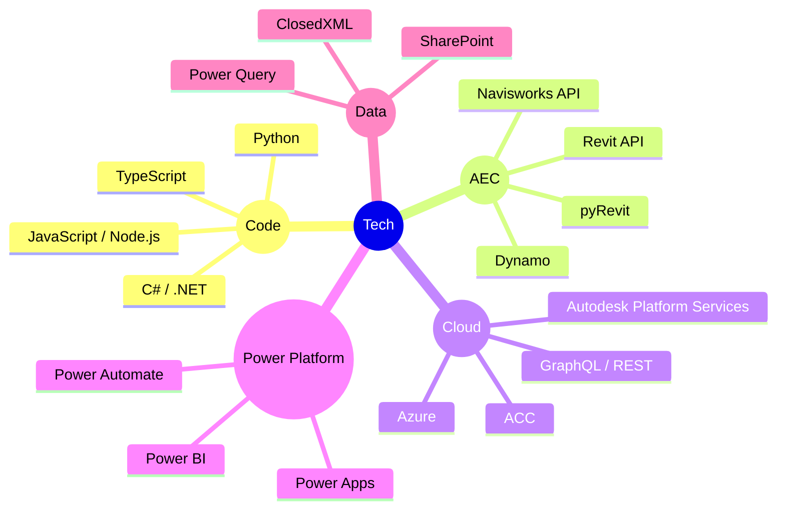

# J K Roshan Kerketta

BIM Manager — Architect — Automation & Solutions Developer

Architect-turned-developer building automation tools, cloud platforms, and data pipelines that make BIM delivery faster and more reliable across the AEC industry. Ten years on airports, stadiums, high-rise towers, and giga-projects — now at OBMI in Dubai.

*Dreaming, Developing, Deploying.*

---

## Focus

> **BIM Automation · Revit & Navisworks Add-ins · Autodesk Platform Services · Power Platform · AI Workflows**

## Currently Building

- 🧭 **OBMI Meridian** — one platform to deploy, license and track every BIM add-in across the office
- 🏃 **OBMI Move30** — rolling out to teams for the 30x30 Wellness Challenge
- 🤖 **AI automations** — turning repetitive BIM coordination work into one-click tools

## Projects I've Delivered On

> NEOM Trojena · Al Maktoum International Airport · Bin Rashid Stadium · Ras El Hekmah · Wadi Yemm

## Connect

  
  &nbsp;
  
  &nbsp;
  

## Tools

## Work

| Name | Description | Link | Status | Tech Stack |
| --- | --- | --- | --- | --- |
| OBMI Meridian | Command centre for OBMI's BIM data — add-in deployment, shared credentials, and global usage tracking | Internal | Work in Progress | Node.js · Express · APS · Azure |
| ACC Model Health Check | Automated health reporting for Revit models hosted on Autodesk Construction Cloud | Internal | Completed | Node.js · APS |
| TIDP / MIDP Checker | Validates information delivery plans against ACC deliverables | Internal | Completed | Node.js · APS |
| Workset Manager | pyRevit extension for bulk element-to-workset assignment with Excel rule import | Internal | Completed | Python · pyRevit · WPF |
| ClashCommentSync | Navisworks add-in to export and import clash comments via Excel | Internal | Completed | C# · Navisworks API · ClosedXML |
| Clash Tolerance Updater | Bulk clash-test tolerance updates through the Navisworks Clash API | Internal | Completed | C# · Navisworks API |
| ACC → Power BI Live Data | Live Revit data in Power BI Online via the APS Data Exchange GraphQL API | Internal | Completed | Power Query M · GraphQL · APS |
| OBMI Move30 | Web app for OBMI's 30x30 Wellness Challenge with Microsoft 365 sign-in and wearable sync | Internal | Work in Progress | React · PWA · Microsoft 365 |
| obmiAppCosting | Costing app for OBMI applications | [GitHub](https://github.com/roshanjohnOBMI/obmiAppCosting) | Completed | TypeScript |

---

## Stats

  
  

## Trophies

---

## Activity

